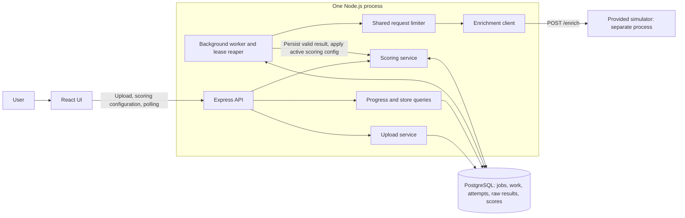
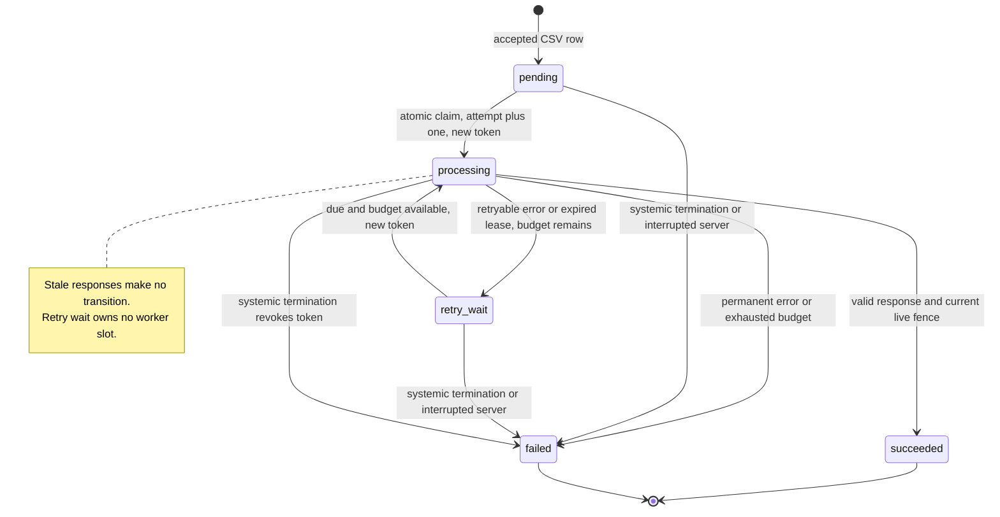

# TierForge architecture — Phase 0 proposal

Status: Phase 7 database-backed read APIs are implemented alongside the foundation, ingestion, resilient enrichment lifecycle, and configurable scoring. They expose consistent progress, paginated stores/failures, and current-revision dashboard statistics. The React dashboard remains future work. See [current schema](database-schema.md), [CSV policy](csv-ingestion.md), and [enrichment policy](enrichment-engine.md).

## Authority and scope

The [original assignment](requirements/tierforge-requirements.md), read in full including Sections 4–7, defines the mandatory workflow and resilience behavior. The [simulator README](../enrichment_simulator/README.md) defines its documented contract. The user's Phase 0 brief fixes the stack, PostgreSQL queue, fencing, process-wide limiter, polling, and set-based scoring. Concrete policies below are **implementation decisions**, detailed in [decisions and assumptions](decisions-and-assumptions.md); they are not additions to the original assignment.

Core is one active enrichment job, with retained results available for scoring and viewing. Multiple concurrent jobs and full restart resumability are bonuses. Keep implementation within 2–3 days by using one Node process and PostgreSQL, with the supplied simulator running separately.

## Components and responsibilities

- `apps/web`: React/TypeScript/Vite, Tailwind, TanStack Query. CSV upload, validation feedback, progress polling, scoring configuration, tier counts, paginated tier-filterable stores, and failure details.
- Express routes: validate multipart uploads, route parameters, filters, and scoring payloads with Zod; expose consistent JSON errors. Return after durable upload acceptance, not after enrichment.
- Upload service: parse CSV correctly, validate the entire bounded file, and create the job and one work row per store atomically.
- Worker module: dispatch loop, bounded concurrency, shared request limiter, retry scheduling, timeout control, and an independent lease reaper. It runs within the API process, not as a separate service.
- Enrichment client: send the documented five request fields, validate response identity and metrics, classify transport/HTTP errors. It does not calculate scores.
- Scoring service: own the bar/weight formula, tier comparison, immutable configuration revisions, and set-based SQL. It has no network or enrichment-client dependency.
- Repositories: parameterized SQL through `pg`, explicit transaction clients, ordered locks, constraints, and migrations. PostgreSQL is both the durable queue and application datastore.
- The supplied Python simulator remains unchanged. Docker Compose supplies PostgreSQL; Node and simulator can run on the host for a simple local setup.



## CSV upload flow

1. Accept one multipart `file` through `POST /api/jobs`. Limit to 10 MiB and 10,000 data rows as configurable decisions; the supplied 5,000-row file fits. Reject oversize uploads before unbounded buffering.
2. Parse with a maintained CSV parser in a later phase; support quoted commas/newlines, CRLF/LF, and an optional UTF-8 BOM. Do not split on commas manually.
3. Require the exact headers `store_id`, `store_name`, `address`, `city`, `state`, and `country`, in any order. Trim outer header whitespace; reject missing or duplicate headers; accept and ignore extra columns with a warning. Require nonblank values in the six fields, consistent row widths, and unique case-sensitive trimmed store IDs within the upload. These row/duplicate policies exceed the assignment's basic header requirement and are explicit choices.
4. Collect bounded errors with row numbers and field names (first 100, plus total error count). Reject the whole invalid file, including empty data files, with no accepted job/work rows. No partial import in core.
5. In one transaction create a `running` job and batch-insert all stores as `pending` work. A partial unique index on a constant for running jobs prevents two concurrent uploads from creating active jobs; translate the uniqueness conflict to `409 ACTIVE_JOB_EXISTS` with the existing job ID. Do not rely on a read-then-insert check.
6. Commit before returning `202` with job ID, status, store count, and status URL. The worker discovers rows in PostgreSQL. Request completion does not trigger or wait for enrichment itself.

A lost HTTP response after commit can leave an accepted job visible through `GET /api/jobs/current`; upload idempotency keys are deferred. Reject new active uploads cleanly without replacing existing work.

## Enrichment lifecycle

```mermaid
sequenceDiagram
    participant UI as Browser
    participant API as Express
    participant DB as PostgreSQL
    participant W as Worker
    participant L as Shared limiter
    participant E as Simulator
    participant R as Independent lease reaper
    UI->>API: Upload validated CSV
    API->>DB: Atomic job plus pending work insert
    API-->>UI: 202 plus job ID
    W->>DB: Claim due row; new token; increment attempt; lease
    DB-->>W: Claimed store and token
    W->>L: Wait for dispatch permission
    L-->>W: Permit at actual dispatch time
    W->>E: POST /enrich with bounded timeout
    alt Valid response before deadline and lease expiry
        E-->>W: 200 and metrics
        W->>DB: Guard token; persist raw result, score if configured, success
    else Retryable failure or timeout
        W->>DB: Guard token; persist error and retry due time or final failure
    else Worker goes silent
        R->>DB: Expired lease: revoke token; retry due time or final failure
        E-->>W: Old response arrives later
        W->>DB: Guard fails; no result/state/count mutation
    end
    UI->>API: Poll job and stores
    API->>DB: Read durable progress and one score revision
    API-->>UI: Counts, states, failures, metrics, scores, tiers
```

### Atomic work claiming and lock order

For every transaction that changes work, attempts, raw results, scores, or a job's terminal state, lock the owning job row first, then work rows in stable ID order. The job lock briefly serializes mutations for a single job, a deliberate simplicity trade-off at five dispatches per second. No asynchronous external work occurs while these locks are held.

Within a claim transaction: confirm the job is running; select a `pending` row or a due `retry_wait` row with `attempt_count < max_attempts` using `SELECT ... FOR UPDATE SKIP LOCKED`, ordered by eligibility time then row ID; atomically update it to `processing`, increment `attempt_count`, assign a fresh random UUID lease token, set `lease_expires_at` from database time, and insert its attempt record. Commit and return the claimed row. Never split selection and ownership update across transactions. An attempt budget includes claimed work even if it dies before dispatch, so silent claimers cannot loop forever.

Use small claims, up to available local slots; do not reserve thousands of leases in advance. `SKIP LOCKED` supplies safe disjoint selection, while the common job lock ensures systemic termination, scoring publication, and completion have one serialization order. Integration tests must use independent database connections even though core uses one process.

### Request admission and timeout

Use one process-wide limiter at the HTTP dispatch boundary, shared by initial attempts and future retries. Use a monotonic clock, no accumulated burst capacity, 220 ms between dispatch starts, and serialized admission that forbids a sixth start in any trailing one-second window. Re-evaluate the clock immediately before dispatch; never pre-allocate future permits that could fire together after an event-loop stall. The 220 ms spacing is a conservative implementation margin, not a changed upstream contract.

Reserve an available concurrency slot, claim one row, then wait for admission without holding database locks. Recheck local cancellation/job-stop signals and lease validity before dispatch; expired claims are not sent. Waiting for admission consumes lease time but not an HTTP timeout. Claiming already consumed the attempt budget. If no work is due, sleep until the nearest retry time or a short poll; do not spin. Backoff is persisted as `next_attempt_at`, so waiting retries hold no slot.

Default logical concurrency is six. The 8-second logical deadline starts at dispatch and covers receiving/reading the complete response body. It wins independently of whether abort settles the transport, allowing the owned attempt to enter retry wait and releasing the worker loop. The abandoned promise retains rejection handling. General recovery of processing rows lost to a crashed worker/process remains a next-phase watchdog concern.

The limiter regulates this application's sends, not other callers of the simulator. Do not run another worker process, development duplicate worker, or manual enrichment load alongside it expecting a global guarantee. Normal network timing can still produce a 429, which remains retryable. Health checks are documented as unmetered and are not enrichment attempts.

### Retry classification

- Retry HTTP 429, HTTP 500/other 5xx, timeout, and network/connection failures. At most five attempts total (initial plus four retries).
- For failed attempt number `n`, select full jitter uniformly from `0` to `min(30 seconds, 1 second * 2^(n-1))`. Persist the selected retry timestamp, do not recompute it on every scan.
- If 429 or a transient 5xx supplies a valid `Retry-After` delta or HTTP date, honor it as a lower bound on both the next retry and shared limiter cooldown. The README does not promise this header. Missing/malformed headers use jitter plus normal paced admission. A future systemic policy may bound excessive provider cooldowns; Phase 4 honors the value rather than violating it.
- Treat non-429 4xx as permanent failures for that store; 401/403/404/405 identify a likely job-wide integration/configuration failure and trigger immediate systemic termination. No credentials are required by the documented simulator.
- A 200 with mismatched `store_id`, missing fields, nonnumeric/nonfinite/negative metrics, or malformed JSON is a contract failure, never success. Do not substitute zero values. Fail that store without retry; repeated contract failures participate in systemic detection.
- Persist structured codes, safe messages, HTTP status, attempt number, and timestamps. Avoid raw upstream HTML or exception stacks in user-visible errors. Limit captured error text to 2 KiB.

### Leases, fencing, and worker recovery

Default lease length is 20 seconds, greater than the 8-second HTTP deadline plus admission and persistence margin. Use database wall-clock time evaluated after locks are acquired for expiry comparisons, not application clocks or a transaction-start timestamp that became stale while waiting. Phase 5 implements the one-second general reaper.

Every success/failure/timeout callback checks, under locks: job still `running`, store still `processing`, submitted token equals its current token, and lease remains unexpired. A guarded transition affecting zero rows means ownership was lost; return without mutating results, attempt outcome, scoring, counters, or job failure streak. Emit a diagnostic stale-response log only.

For success, fence validation, raw-result insert, attempt completion, and the work transition to `succeeded` share one transaction. Never insert metrics before proving ownership. A unique raw-result key on work ID is a second defense; uniqueness alone is not the fence. Error persistence and retries use the same guard. Scoring is authorized only after the job is terminal, so enrichment completion never needs to update scores.

The reaper locks the job then expired rows, marks their current attempts `lease_expired`, revokes tokens, and either schedules `retry_wait` or marks `failed` when budget is exhausted. Reclaimed work is picked up by another available worker task with a **new** token. Abort the old local request where possible; correctness never depends on the abort succeeding. Both an early timeout and the reaper may race, but only the current eligible state transitions once.

No lease heartbeats in core: a single request should complete within its bounded HTTP deadline. Do not extend the lease indefinitely for a delayed upstream response. Startup discovers the one queued or running job, resumes pending/due work, and lets the watchdog reclaim abandoned processing leases after expiry. This provides practical single-process recovery without claiming multi-process or exactly-once restart semantics.



### Systemic failure and job completion

A job stores a consecutive dependency-failure streak, updated in the same serialized transaction as an accepted attempt outcome. Count 429, 5xx, network errors, timeouts, lease expiry, and malformed success responses; reset on accepted success. Other store-local permanent errors neither increment nor reset it. Stale callbacks do neither. Stop at 30 consecutive counted failures, or immediately for the explicit configuration errors above. This is an intentionally configurable heuristic, not an assignment-prescribed threshold.

Even jobs smaller than 30 attempts terminate: each store has a finite attempt budget. If none succeed, final job state is `failed`; if some succeed and some fail after normal exhaustion, `completed_with_errors`; if all succeed, `completed`. A systemic stop always sets the job `failed`, even when partial successes exist, and preserves those successes for inspection/scoring.

Systemic termination takes the job lock, marks every unfinished row `skipped` with `JOB_ABORTED_SYSTEMIC_FAILURE`, clears leases/tokens, and records the failed job reason atomically. Original completed failures keep their reasons, and successful enrichments remain intact. New dispatch stops because claims require a running job; any escaped response is fenced. Derive progress from work rows to avoid counter drift. Multiple finalizers are idempotent.

On database outage, stop dispatch because claims cannot be persisted. Do not infer success from memory. Retry connectivity with bounded operational backoff; after recovery the reaper resolves leases. No persistence guarantee is possible while PostgreSQL is unavailable; logs and health responses expose the outage. There is no promise that an already sent upstream request is called exactly once: delivery is at least once, while accepted result application is fenced to one current attempt.

## Scoring and tiering

For each successful store:

`score = (footfall >= footfall_bar ? footfall_weight : 0) + (revenue >= revenue_bar ? revenue_weight : 0) + (size >= size_bar ? size_weight : 0)`

Weights are percentage points from 0 through 100 and sum exactly to 100. Bars and metric comparisons are inclusive. Assign `Large` when `score >= large_min`; otherwise `Medium` when `score >= medium_min`; otherwise `Small`. No normalization, proportional metric contribution, or ranges. Validate finite nonnegative bars and `0 <= medium_min < large_min <= 100` (the strict ordering is a UI/configuration decision).

Use PostgreSQL `numeric`, not floating-point accumulation. Accept up to two decimal places for configuration values as an explicit precision policy; reject excess precision rather than silently round. Convert decimal JSON strings to validated exact decimal values at the API boundary; use integer hundredths for any TypeScript weight-sum validation. Format a display percentage only after assigning the tier.

The assignment's example must produce A=100/Large, B=50/Medium, C=20/Small using bars 15000/150000/8000, weights 50/30/20, and boundaries 70/40. Test exact equality to bars and boundaries, plus 0 and 100.

Submitting a configuration requires a terminal job, acquires the job lock, allocates a monotonically increasing revision, stores an immutable config, and performs one `INSERT ... SELECT` with `CASE` expressions over successful enrichment rows, all in one transaction. A failed calculation rolls back the config and scores together; the highest previously committed revision remains current. Core uses synchronous recalculation for 5,000 rows rather than adding another queue prematurely.

Configuration can be submitted for `completed`, `completed_with_errors`, or `failed` jobs. Only `succeeded` work rows with persisted enrichments are scored; failed and skipped rows receive no fabricated score. The enrichment HTTP client and worker do not import scoring. Older revisions remain historical snapshots, and each committed revision covers the terminal job's successful stores.

Scoring-only actions must make **zero** enrichment calls. Prove this with a dependency spy/forbidden transport in tests. Keep raw payload and typed metric columns unchanged across any number of recalculations. Before the first config, scores/tiers are null and tier counts are zero; failed/pending stores have no score, not Small by default.

## Database relationships and integrity

Proposed entities and concrete column/index details are in the [implementation plan](implementation-plan.md#database-schema-proposal-historical-phase-0-design).

- `jobs` has many `store_work` rows, each representing one uploaded store and durable work unit.
- `store_work` has many `enrichment_attempts` and at most one accepted `enrichment_results` row.
- `jobs` has many immutable `scoring_configs`; the highest committed revision is current without a separate pointer.
- `scoring_configs` and successful `enrichment_results` produce `store_scores`, keyed by config and work row, with same-job foreign-key integrity.

Use foreign keys, unique `(job_id, store_id)`, unique attempt numbers per work row, valid-state checks, lease-field consistency checks, positive attempt limits, weight-sum constraints, and tier/score bounds. Index due and expired work separately, and scores by config/tier/store for paginated filtering. Do not introduce a global store master: the same store ID may occur in separate sequential uploads.

## API and dashboard contract

Implemented endpoints, except where explicitly marked future:

- `POST /api/jobs`: multipart upload; `202` on durable acceptance; `400` malformed CSV, `422` validation, `413` limits, `409` active-job conflict.
- `GET /api/jobs/:jobId`: job lifecycle timestamps/failure fields plus all six persisted work-state counts and derived progress.
- `GET /api/jobs/:jobId/stores?tier=Large&page=1&pageSize=50`: stable store-ID ordering, SQL-filtered count, original store fields, work status, nullable metrics, current-revision score/tier, and last error. Tier is optional; page size is capped at 100.
- `GET /api/jobs/:jobId/failures?page=1&pageSize=50`: stable, paginated failed and skipped records with attempt count and final error. The final status keeps those outcomes distinguishable.
- `GET /api/jobs/:jobId/dashboard`: job summary, enrichment/failure/skip totals, current-revision scored/tier counts, and current scoring configuration.
- `POST /api/jobs/:jobId/scoring`: bars, weights, tier thresholds; `201` with revision, scored count, and tier counts after atomic calculation. Each accepted submission produces a new revision.
- `GET /api/jobs/:jobId/scoring`: highest committed configuration and summary, or a null configuration before scoring.
- `GET /api/health`: app/database readiness, `503` on DB failure. Optional simulator `/health` is advisory; it is not proof `/enrich` will succeed.

Dashboard unfinished work is `pending + processing + retry_wait`; terminal work is `succeeded + failed + skipped`. Dashboard progress/tier counts use one statement snapshot. Store page records and their filtered total use a repeatable-read transaction. Both score views join the highest committed configuration revision, so old revisions neither duplicate rows nor affect current counts. Before configuration, scored and tier counts are zero and all store scores/tiers are null. Failed and skipped rows remain visible through the separate failure endpoint even when a store tier filter is active.

Use TanStack Query to poll active jobs every two seconds, pause in hidden tabs, and stop automatic progress polling at terminal state; invalidate relevant queries after upload/scoring. Show retry waiting as pending, display terminal job reasons, and retain partial successful results after failure. Label 'category-equivalent metrics' as the three enrichment metrics; no category field is supplied or required by the contract.

## Errors, trade-offs, and limits

Return `{error: {code, message, details?, requestId}}` for application HTTP errors. Use `404` for unknown IDs, `422` for bad scoring inputs, and `503` for unavailable persistence. Surface actionable row errors and upstream failure categories. Use structured logs with job/work/attempt IDs, token, duration, HTTP outcome, retry due time, and stale-discard events; do not log whole CSVs or unsanitized response bodies.

A constant-rate single-process scheduler is sufficient for core and easy to explain; it does not promise cross-process coordination. A job-row lock favors correctness and a short implementation over maximum database parallelism. Bulk scoring briefly delays work persistence; bound statement/lock duration and measure against the 20-second lease. A five-second scoring statement timeout is a proposed safeguard; rollback leaves the prior config intact.

At five requests/second, 5,000 first attempts alone require at least 1,000 seconds (16 minutes 40 seconds), ignoring latency and retries. The implemented 220 ms spacing raises this floor to about 18 minutes 20 seconds; concurrency and injected delays may extend it. Do not promise a complete full-sample demonstration in a few minutes. Progress and future re-scoring remain independently responsive.

Bounded uploads, stricter row validation, no automatic upload idempotency, interrupted-run termination, and immutable score history are explicit decisions. Authentication, distributed infrastructure, animated UI, and unrequested exports are outside core. The sample generator is missing; README details still needing verification are tracked separately. No runtime simulator behavior has been verified in Phase 0.
