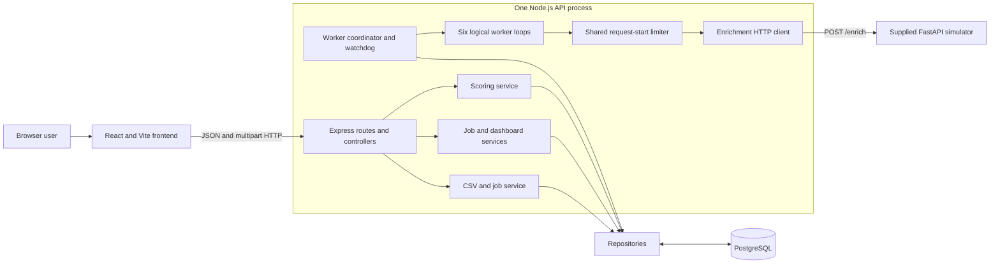
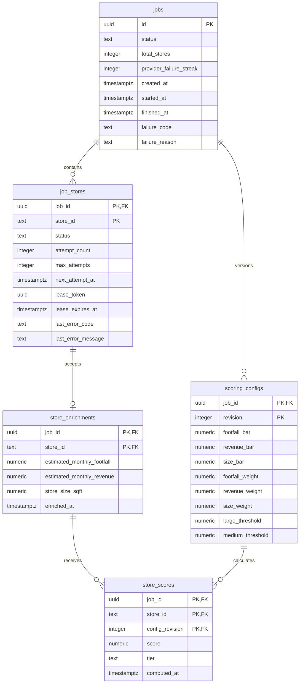
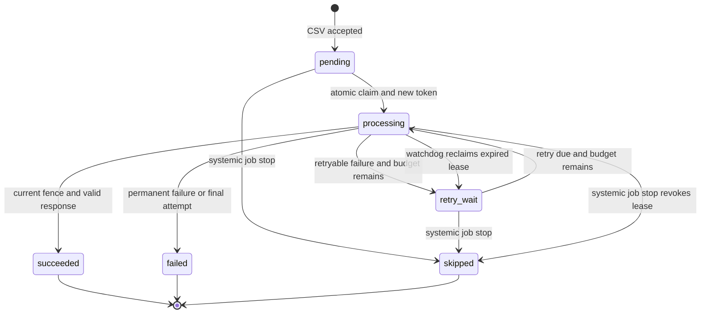

# TierForge architecture

## Scope and authority

This document describes the implemented Phase 10 system. The [original Sigmoid assignment](requirements/tierforge-requirements.md) defines required behavior; the [supplied simulator README](../enrichment_simulator/README.md) defines the external HTTP contract. The executable database schema is the ordered SQL in `apps/api/migrations/`.

TierForge processes one active enrichment job at a time. A single Node.js API process owns six logical worker loops and one shared request-start limiter. PostgreSQL stores application data and durable work state. Multiple active jobs, multiple API replicas, and the assignment’s full restart-resumability bonus are not part of the implemented core.

## Components



The frontend uses React Router for URL-scoped job pages and TanStack Query for server state. It polls only queued or running jobs and stops automatic progress polling at a terminal state. The browser never accesses PostgreSQL directly.

Express routes parse transport input, Zod validates request boundaries, controllers translate service results, services coordinate use cases, and repositories own parameterized SQL and transactions. Importing `createApp` starts no listener, pool, or worker; `server.ts` owns process lifecycle.

## Database relationships



A partial unique index over queued and running `jobs` enforces the single-active-job rule at the database level. Composite primary and foreign keys keep stores, enrichments, configurations, and scores within the same job. Check constraints enforce states, lease-field consistency, retry eligibility, nonnegative metrics, weight totals, threshold ordering, score bounds, and valid tiers.

`job_stores` is both the original store record and the durable unit of work. There is no separate attempt-history table. It retains only the current workflow state, total attempt count, current lease, next retry time, and last error. `store_enrichments` contains at most one accepted metric set per job/store. Scoring configurations and scores retain immutable revisions; the highest committed revision is current.

## CSV ingestion and job creation

`POST /api/jobs` accepts a multipart field named `file`. Multer applies the configured byte limit before parsing. `csv-parse` handles UTF-8, quoted commas and newlines, CRLF/LF, and empty lines. The service trims surrounding whitespace, requires the six case-sensitive headers, rejects duplicate headers, validates every required value, rejects duplicate store IDs, and ignores documented extra columns with a warning.

After complete validation, one transaction inserts a queued `jobs` row and batches `job_stores` inserts in groups of 500. Any insert failure rolls back the job and all store rows. Concurrent submissions are resolved by the active-job unique index rather than a read-before-write check. The API returns HTTP 202 only after the transaction commits, then notifies the coordinator asynchronously.

## Enrichment lifecycle

```mermaid
sequenceDiagram
    participant UI as React UI
    participant API as Express API
    participant DB as PostgreSQL
    participant W as Worker
    participant L as Shared limiter
    participant E as Simulator
    participant R as Watchdog

    UI->>API: POST /api/jobs with CSV
    API->>DB: Transaction: queued job and pending stores
    DB-->>API: Commit
    API-->>UI: 202 with job ID
    API->>W: Notify coordinator
    W->>DB: Lock job; claim eligible store; increment attempt; assign lease token
    DB-->>W: Commit claimed store
    W->>L: Wait for request-start admission
    L-->>W: Admission
    W->>DB: Confirm claim is still current and unexpired
    alt Current claim
        W->>E: POST /enrich with logical timeout
        alt Valid response before timeout and lease expiry
            E-->>W: Metrics
            W->>DB: Fenced transaction: insert enrichment and mark succeeded
        else Retryable failure or timeout
            W->>DB: Fenced transaction: persist error and retry time or fail
        else Permanent failure
            W->>DB: Fenced transaction: persist final failure
        end
    else Lease expired or revoked while waiting
        W-->>W: Skip dispatch
    end
    R->>DB: Periodically reclaim expired processing leases
    UI->>API: Poll persisted progress
    API->>DB: Aggregate store states
    API-->>UI: Counts, failures, and terminal status
```

### Claiming and ownership

A claim transaction follows one lock order: lock the job row, then select one eligible store using `FOR UPDATE SKIP LOCKED`. Eligibility is pending work or retry-wait work whose `next_attempt_at` is due and whose attempt budget remains. The same transaction changes the row to processing, increments `attempt_count`, generates a UUID `lease_token`, and sets `lease_expires_at` from database time.

The transaction commits before rate-limit waiting or network I/O. Two database connections cannot own the same store because the selected row remains locked until its ownership update commits; `SKIP LOCKED` lets another worker select different eligible work instead of blocking on it.

### Shared request rate and concurrency

Concurrency and request rate serve different purposes. Six worker loops allow other stores to progress while an HTTP call is waiting, but every initial request and retry passes through one process-wide limiter. Admission is serialized and request starts are separated by at least 220 ms, so this deployment starts no more than five requests in any rolling 1,000 ms window and accumulates no burst credit.

The limiter rechecks its deadline after every sleep. If a request receives a valid `Retry-After`, queued callers observe the extended process-wide cooldown. Immediately after limiter admission, the worker confirms its claimed token is still current and unexpired before sending the request.

### Retry and recovery flow



HTTP 429, HTTP 5xx, network failures, and logical timeouts are retryable. Non-429 4xx responses and invalid success payloads are permanent for the store; 401, 403, 404, and 405 also trigger immediate systemic termination because they indicate likely configuration or contract failure.

Retry delay uses full jitter from zero through `min(RETRY_CAP_MS, RETRY_BASE_MS × 2^(attempt-1))`. A valid `Retry-After` is a lower bound. The selected database-time `next_attempt_at` is persisted, so retry waiting survives coordinator cycles and consumes no worker promise or connection.

Each request races the entire Fetch operation, including body parsing, against `ENRICHMENT_TIMEOUT_MS`. Abort is requested at timeout, but correctness does not assume the remote operation stops. The worker loop can continue while the abandoned promise remains observed to prevent unhandled rejection.

The watchdog runs independently of the request promise. Every `LEASE_REAPER_INTERVAL_MS`, it finds processing rows whose lease expired. Under the job and store locks, it revokes the old token and either schedules another attempt or records `RETRY_EXHAUSTED`. A successful worker and watchdog racing for the same row cannot both transition it.

### Late-response fencing

Every attempt-dependent database write requires all of the following under transaction locks:

1. The job is still running.
2. The store is still processing.
3. The submitted UUID token equals the row’s current `lease_token`.
4. The lease has not expired according to PostgreSQL time.

A timeout or watchdog recovery clears token A; retry claim B installs a new token. If request A later succeeds or fails, its update affects no row and is logged as stale. It cannot overwrite B’s metrics, increment job failure state, regress terminal status, or create a duplicate enrichment. The `(job_id, store_id)` enrichment primary key is a second defense, while the lease token is the ownership decision.

### Systemic failure and finalization

Accepted provider-related failures increment `jobs.provider_failure_streak` in the same transaction as store failure handling. An accepted success resets it. At the configured threshold, the transaction fails the job, records a clear reason, marks every unfinished row skipped, clears leases, and preserves earlier successes and completed failures. Integration-style 401/403/404/405 responses stop the job immediately.

If normal bounded processing finishes, all successes produce `completed`, mixed success/failure produces `completed_with_errors`, and no successes produce `failed`. Progress is derived from `job_stores`; there are no callback-maintained counters that can drift.

## Scoring and rescoring

```mermaid
sequenceDiagram
    participant UI as React UI
    participant API as Scoring API
    participant DB as PostgreSQL

    UI->>API: Submit bars, weights, and tier thresholds
    API->>API: Validate decimals, weight sum, and threshold ordering
    API->>DB: Begin transaction and lock terminal job
    API->>DB: Allocate and insert next immutable config revision
    API->>DB: INSERT SELECT scores from successful persisted enrichments
    API->>DB: Commit configuration and all scores together
    DB-->>API: Scored count and tier counts
    API-->>UI: 201 with revision and summary
    UI->>API: Submit changed configuration
    Note over API,DB: Same database-only transaction; no simulator call
```

The score is the sum of weights whose metrics meet or exceed their bars. PostgreSQL `numeric` and decimal-string validation avoid floating-point business calculations. Large and Medium comparisons are inclusive; all other scored stores are Small. Only successful stores with persisted enrichment rows are scored.

Each submission locks a terminal job, assigns the next revision, inserts its configuration, and calculates every score with one set-based `INSERT ... SELECT` in the same transaction. A failure rolls back both configuration and scores, leaving the previous highest committed revision current. Scoring code has no enrichment-client dependency, so rescoring makes zero simulator calls.

## Read model and frontend behavior

Job details aggregate all six store states in one SQL snapshot. Dashboard tier counts join only the highest committed scoring revision; unscored stores are not counted as Small. Store and failure endpoints use stable `store_id` ordering and server-side pagination. Tier filtering and its total count occur in PostgreSQL, not after fetching a page. Store pages use a repeatable-read transaction so records and totals agree.

The React application runtime-validates API responses with Zod, preserves decimal strings until display, and exposes loading, validation, failure, unscored, empty, and partial-success states. Job IDs are part of the URL, allowing refresh and local sharing.

## Error handling and security

API errors use this envelope:

```json
{
  "error": {
    "code": "MACHINE_READABLE_CODE",
    "message": "Safe explanation",
    "details": {},
    "requestId": "correlation identifier"
  }
}
```

Controllers use 400/413/415/422 for malformed uploads or input, 404 for unknown jobs/routes, 409 for the active-job conflict, 503 for database readiness failure, and 500 for unexpected errors. Persisted store failures remain data in successful read responses.

All application SQL uses parameters. Environment input is validated before startup. Validation errors expose field names rather than credential-bearing values. Pino logs structured identifiers and outcomes while redacting password, database URL, and authorization fields; error middleware does not return stacks or raw upstream response bodies. `.env`, local databases, logs, virtual environments, and generated output are ignored by Git.

## Trade-offs and limits

- PostgreSQL replaces a separate queue service, reducing operational scope while providing durable scheduling, locking, transactions, and constraints. The job-row lock prioritizes correctness over maximum per-job database parallelism.
- The shared limiter is correct for one API process. Multiple replicas or concurrent jobs would need shared rate admission and fair scheduling.
- Startup discovers one queued/running job and the watchdog reclaims expired work. This provides practical recovery, but it is not the bonus guarantee of full restart resumability or exactly-once HTTP delivery.
- The HTTP dependency may execute an attempt more than once because there is no transaction spanning PostgreSQL and the simulator. Fencing makes accepted database completion effectively once per store.
- Uploads are buffered with explicit byte and row limits, appropriate for the supplied 5,000-row file but not streaming-scale ingestion.
- Immutable scoring history simplifies publication and auditability but grows with every rescore and has no retention workflow.
- Attempt history and raw upstream payload archival are omitted; only attempt count, current scheduling/lease data, last error, and accepted typed metrics are stored.
- At five requests per second, 5,000 first attempts require at least 16 minutes 40 seconds before latency and retries. The 220 ms safety interval raises the local scheduler floor to about 18 minutes 20 seconds.

Detailed validation policies are in [CSV ingestion](csv-ingestion.md), [database schema](database-schema.md), and [enrichment engine](enrichment-engine.md). Final evidence is in [requirement verification](requirements-verification.md), the [Phase 9 verification report](phase-9-report.md), and the [Phase 10 submission report](phase-10-report.md).
